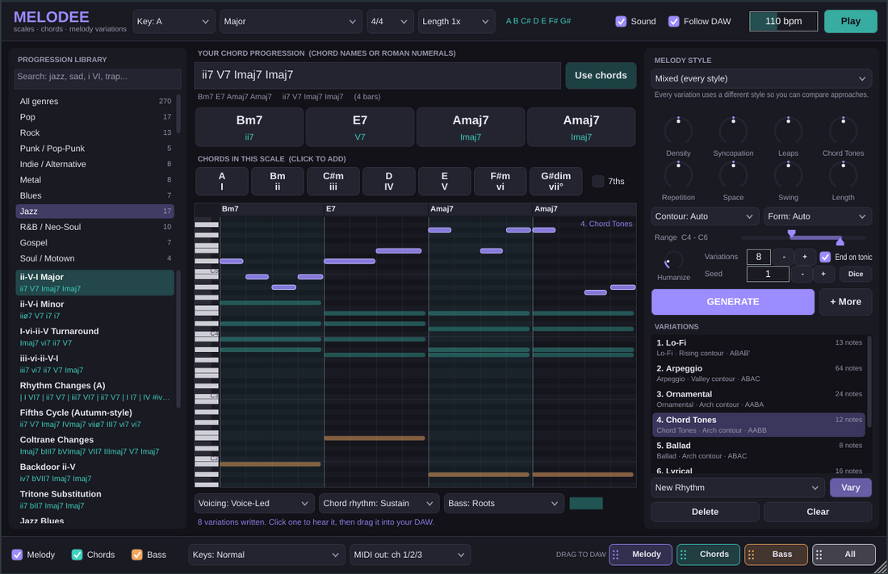

# Melodee

**A melody and chord plugin for your DAW.** Pick a key and any scale, type a chord progression (or pick
one from 270 progressions in 45 genres), and Melodee writes as many melody variations as you want:
in 23 different styles, each one shaped by your settings, all playing in time with your DAW. Drag the
melody, chords or bass straight onto a track.



Formats: **VST3** (Windows, macOS, Linux), **AU** (macOS / Logic / GarageBand), **LV2** (Linux) and a
**Standalone app**. There is also a command-line version that writes `.mid` files.

---

## What's inside

### 1. Every scale: 104 scales and modes in every key

All 12 keys, with sharps or flats spelled the way the key is written (Bb, Eb, Ab and Db major; D, G, C, F, Bb
and Eb minor use flats).

| Family | Scales |
|---|---|
| Major & minor | Major, Natural Minor, Harmonic Minor, Melodic Minor, Harmonic Major |
| Church modes | Ionian, Dorian, Phrygian, Lydian, Mixolydian, Aeolian, Locrian |
| Harmonic minor modes | Locrian ♮6, Ionian #5, Dorian #4 (Ukrainian Dorian), Phrygian Dominant, Lydian #2, Super Locrian bb7 |
| Melodic minor modes | Dorian b2, Lydian Augmented, Lydian Dominant, Mixolydian b6, Locrian ♮2, Altered |
| Harmonic major modes | Dorian b5, Phrygian b4, Lydian b3, Mixolydian b2, Lydian Augmented #2, Locrian bb7 |
| Double harmonic modes | Double Harmonic Major (Byzantine/Arabic), Lydian #2 #6, Ultraphrygian, Hungarian Minor, Oriental, Ionian #2 #5, Locrian bb3 bb7 |
| Pentatonic | Major, Minor, Egyptian, Blues Major/Minor Pentatonic, Dominant, Minor 6, Major b6, Minor-Major 7 |
| Blues | Blues, Major Blues, Nine-Note Blues, Blues Dorian |
| Bebop | Bebop Dominant, Major, Dorian, Melodic Minor, Harmonic Minor |
| Symmetric | Whole Tone, Diminished (W-H and H-W), Augmented, Tritone, Messiaen modes 3-7, Chromatic |
| Hexatonic | Major/Minor Hexatonic, Ritsu, Prometheus, Prometheus Neapolitan, Raga Kumud |
| Japanese | Hirajoshi, In, Insen, Iwato, Yo, Kumoi, Ryukyu |
| World & exotic | Neapolitan Major/Minor, Hungarian Major, Hungarian Gypsy, Romanian Major, Persian, Enigmatic, Major Locrian, Leading Whole Tone, Spanish 8-Tone, Flamenco, Algerian, Todi, Purvi, Marva, Pelog, Chinese, Tezeta Minor, Bhairavi, Kafi |

Lookups also work by other names (Aeolian, Spanish Gypsy, Super Locrian, Hijaz, Overtone, Hindu...).
Microtonal maqams and ragas are approximated in 12-tone equal temperament.

### 2. Chord progressions from every genre: 270 progressions, 45 genres

Pop, Rock, Punk/Pop-Punk, Indie/Alternative, Metal, Blues, Jazz, R&B/Neo-Soul, Gospel, Soul/Motown, Funk,
Disco, Hip-Hop, Trap, Drill, Lo-Fi, EDM/Progressive House, House/Deep House, Future Bass, Dubstep, Trance,
Techno, Drum & Bass, UK Garage, Synthwave, Phonk, Hyperpop, Country, Folk, Celtic, Reggae, Dancehall,
Afrobeats/Amapiano, Latin (reggaeton, bossa nova, salsa, bachata, tango), Flamenco, Classical/Baroque,
Cinematic, Video Game, Ambient, K-Pop/J-Pop/Anime, Worship, Musical Theatre, Middle Eastern,
Indian/Bollywood and Modal.

They include the classics: I-V-vi-IV, the 12-bar blues, ii-V-I, rhythm changes, Coltrane changes, the
Andalusian cadence, the royal road, "Just the Two of Us", the gospel 1-4 walk-up, La Folia, the lament bass,
Mario cadence, Phrygian trap and drill loops. They are stored as roman numerals, so they work in any key.
Search them by name, genre, mood or numerals.

**You can type any progression yourself.** Melodee reads chord names and roman numerals:

| You type | Meaning |
|---|---|
| `Am F C G` | chord names, one bar each |
| `vi IV I V` | roman numerals in the current key |
| `ii7-V7-Imaj7` | dashes, commas or spaces between chords |
| `\| Dm7 G7 \| Cmaj7 \|` | bars: chords in a bar share it |
| `Am:2 F:2 C G` | `:2` = two bars (inside `\|bars\|` it is a share of the bar) |
| `C % F` | `%` repeats the previous chord (or bar) |
| `Am F C G x2` | repeat everything so far |
| `V/V`, `V7/vi`, `vii°/V` | secondary chords |
| `I/3`, `V/7`, `C/E`, `Am7/G` | inversions / slash chords |
| `bVII`, `bVI`, `iv`, `#iv°7`, `bII` | borrowed and chromatic chords |
| `N.C.` | no chord |

Chord symbols: `m`, `dim`, `°`, `aug`, `+`, `sus2`, `sus4`, `5`, `6`, `6/9`, `7`, `maj7`/`M7`/`Δ`, `m7`,
`mMaj7`, `m7b5`/`ø`, `dim7`, `9`, `11`, `13`, `add9`, `add11`, `b9`, `#9`, `#11`, `b13`, `alt`, `no3`, `no5`, and any
combination (`C7(b9,#11)`, `Bb13sus4`, `F#m11`, `Ebmaj9#11`).

In a minor key, numerals follow natural minor (`i VI III VII` = Am F C G in A minor); `bVI` means the same
thing, `V` is the major dominant, and `vii°` sits on the raised leading tone.

The **Chords in this scale** buttons show the triads or 7th chords of whatever scale you pick. Click one to
hear it and add it to your progression.

### 3. Melody variations, in depth

Press **GENERATE** and Melodee writes a set of variations (1-32 at a time, **+ More** adds to the list).
Each melody:

- puts chord tones on strong beats, uses passing and neighbour notes in between, and avoids clashes;
- changes its note choice with every chord, including borrowed and chromatic chords (Melodee works out the
  right scale for each chord);
- has phrases: a motif that returns, gets moved onto the next chord (sequence), inverted or answered, and
  phrase endings that breathe and resolve;
- follows a contour (arch, valley, rising, falling, wave, flat) and a phrase form (AABA, ABAB', AABB, ABAC,
  call & response, repeat, through-composed);
- can be 1x, 2x or 4x the length of the progression, for longer, developing lines;
- uses a seed: the same seed and settings always give the same melody.

**23 melody styles**

| Style | What it does |
|---|---|
| Lyrical | Singable top line: mostly steps, chord tones on strong beats, breathing phrases |
| Pop Hook | Catchy, syncopated, repetitive hook built from one short idea |
| Chord Tones | Guide-tone melody: 3rds and 7ths on the beat, outlining every chord change |
| Arpeggio | Broken-chord patterns (up, down, Alberti, broken) that voice-lead between chords |
| Scalar Runs | Flowing scale runs that connect chord tones |
| Motif Development | One short motif, then sequenced, inverted and reversed across the chords |
| Call & Response | A busy question phrase answered by a calmer, resolving phrase |
| Jazz Bebop | Swung 8th-note lines with enclosures and chromatic approach notes |
| Blues | Blue notes, slides and call-and-response licks over a shuffle |
| Pentatonic Riff | Repeating riff from the pentatonic scale |
| Trap / Drill | Dark, repetitive melody with triplet rolls, pockets of space and octave jumps |
| R&B / Neo-Soul | Rich 9ths, 11ths and 13ths, laid-back phrasing and vocal-style runs |
| EDM Lead | Syncopated pluck / lead patterns with octave jumps |
| Lo-Fi | Lazy swing, lots of space, 7ths and 9ths |
| Ballad | Long, expressive notes with wide, resolving leaps |
| Classical | Periodic phrases, sequences and clear cadences with light ornaments |
| Latin / Reggaeton | Dembow and tresillo rhythms (3+3+2) with punchy repeated notes |
| Afrobeats | Bouncy syncopation, pentatonic flavour and call-and-response |
| Rock Riff | Driving riff around the root with pentatonic and blues notes |
| Cinematic | Long, wide, rising lines with octave leaps at the climax |
| Ambient | Sparse, floating tones that favour colour notes (9ths, 11ths, 13ths) |
| Counter Melody | A second line that moves against the chords' top voice |
| Ornamental | Grace notes, mordents, trills and turns |
| **Mixed** | Every variation uses a different style, so you can compare approaches |

**Shaping knobs.** The centre position is the style's own default; turn left for less, right for more:
Density, Syncopation, Leaps, Chord Tones, Repetition, Space (rests), Swing, Length (staccato to legato) and
Humanize. You also set the Range (lowest and highest note), Contour, Form and whether to end on the tonic.

**Vary: 20 ways to turn a melody you like into new ones.** Select a variation, pick a tool, press **Vary**:

| Tool | What it does |
|---|---|
| New Rhythm | Same notes in order, new rhythm |
| New Notes | Same rhythm and shape, new notes |
| Inversion / Retrograde / Retrograde Inversion | Mirror it, play it backwards, or both |
| Embellish | Adds passing and neighbour tones |
| Simplify | Keeps the strong-beat notes and lets them ring |
| Ornament | Trills, mordents, turns and grace notes |
| Syncopate | Pushes notes ahead of the beat |
| Double Time / Half Time | Twice as fast (repeated) or twice as slow |
| Octave Up / Octave Down | Moves it an octave |
| Sequence | Repeats the first bar's idea on every chord |
| Answer Phrase | Keeps the first half as a question and writes a resolving answer |
| Harmonize in 3rds / 6ths | Adds a harmony voice |
| Swing / Humanize | Groove and feel |
| Fit To Chords | Re-fits a melody to new chords after you change the progression |

Changing the key transposes your variations. If you change the chords, press GENERATE or use Fit To Chords.

### 4. Chords and bass

- **11 voicings:** Close, Voice-Led (smoothest movement), Open, Drop 2, Drop 3, Shell, Rootless (jazz),
  Power, Spread (cinematic), Lush (add 9), Quartal.
- **18 chord rhythms:** Sustain, Bar Hits, Half Notes, Quarters, 8ths, Off-beats, Pop 3+3+2, Charleston,
  Tresillo/Dembow, Arp Up, Arp Up-Down, Alberti, Guitar Strum, Piano Ballad, Gospel Pushes, House Stabs,
  Trance Gate, Reggae Skank.
- **10 bass styles:** Roots, Root-Fifth, Disco Octaves, Walking (jazz), Pumping 8ths, Trap 808, Reggae
  One-Drop, Funk 16ths, Arpeggio, Tresillo, or Off. Slash chords put their bass note in the bass.

### 5. Working with your DAW

- **Plays in sync** with your DAW's transport and tempo (or press Play to preview when the DAW is stopped).
- **Built-in sound** (lead, electric piano, bass) so you hear ideas instantly; switch it off to use your own
  instruments.
- **MIDI out:** melody on channel 1, chords on 2, bass on 3 (or everything on channel 1). Route it to any
  instrument.
- **Drag and drop:** drag **Melody**, **Chords**, **Bass** or **All** from the bottom bar onto a track. Click
  instead to save a `.mid` file.
- **Your keyboard:** play normally, *lock to scale* (wrong notes snap into the scale) or *play chords* (white
  keys C, D, E... trigger chord 1, 2, 3... of your progression).
- Everything (progression, settings and every variation) is saved with your project.

See **[docs/INSTALL.md](docs/INSTALL.md)** for setup in FL Studio, Ableton Live, Logic Pro, GarageBand,
Cubase, Studio One, Reaper, Bitwig and others.

---

## Download

Every push to this repository builds Melodee for Windows, macOS and Linux with GitHub Actions:

1. Open the repository's **Actions** tab, then the latest **Build plugin** run.
2. Download **Melodee-Windows**, **Melodee-macOS** or **Melodee-Linux** under *Artifacts*.
3. Unzip and follow [docs/INSTALL.md](docs/INSTALL.md).

Pushing a tag such as `v1.0.0` also publishes the zips on the repository's **Releases** page.

---

## Quick start

1. Load **Melodee** on an instrument track.
2. Choose a **Key** and **Scale** in the top bar (for example A, Natural Minor).
3. Pick a progression from the **library** on the left, or type one (for example `Am F C G` or `vi IV I V`) and
   press Enter.
4. Pick a **melody style** (or keep *Mixed*) and press **GENERATE**.
5. Click variations to hear them over the chords. Use **Vary** to make new versions of the ones you like.
6. Drag **Melody** (or Chords / Bass / All) onto a track in your DAW.

---

## Command-line version

The `melodee` program writes the same melodies, chords and bass as `.mid` files:

```sh
melodee --key A --scale "Natural Minor" --prog "Am F C G" --variations 8
melodee --key C --genre Jazz --pick 2 --style bebop --voicing rootless --bass walking
melodee --key F --prog "i VI III VII" --style trap --transform all --out my_ideas
melodee --list-scales | --list-genres | --list-progressions trap | --list-styles | --list-transforms
```

Run `melodee --help` for every option.

---

## Building from source

Requirements: CMake 3.22+ and a C++17 compiler (Visual Studio 2022, Xcode 14+, GCC 11+ or Clang 14+).
JUCE 8.0.4 is downloaded automatically.

```sh
cmake -S . -B build -DCMAKE_BUILD_TYPE=Release
cmake --build build --config Release
ctest --test-dir build -C Release        # run the tests
```

The plugins are in `build/plugin/Melodee_artefacts/Release/`. On Linux, install
`libasound2-dev libx11-dev libxrandr-dev libxinerama-dev libxcursor-dev libxext-dev libfreetype-dev
libfontconfig1-dev libgl1-mesa-dev` first. Options: `-DMELODEE_BUILD_PLUGIN=OFF` (engine, CLI and tests
only) and `-DMELODEE_JUCE_PATH=/path/to/JUCE` (use a local JUCE).

### Project layout

```
core/      The music engine (plain C++17, no dependencies)
           Scales, Chords, Progression parser, ProgressionLibrary, Harmony (chord scales),
           MelodyGenerator + MelodyStyles + MelodyTransforms, Accompaniment, MidiFile
plugin/    The JUCE plugin: processor, sequencer, preview synth, editor and UI components
cli/       The melodee command-line tool
tests/     Engine tests (scales, chords, numerals, every library progression in every key,
           every style and transform, voicings, MIDI round trip)
plugin/tests/  Processor tests with a simulated DAW transport (sync, MIDI out, keyboard modes,
           save/restore, export)
```

### Licensing note

The plugin is built with [JUCE](https://juce.com), which is dual-licensed under the AGPLv3 and a commercial
licence. If you distribute the plugin, make sure you follow one of JUCE's licences.
